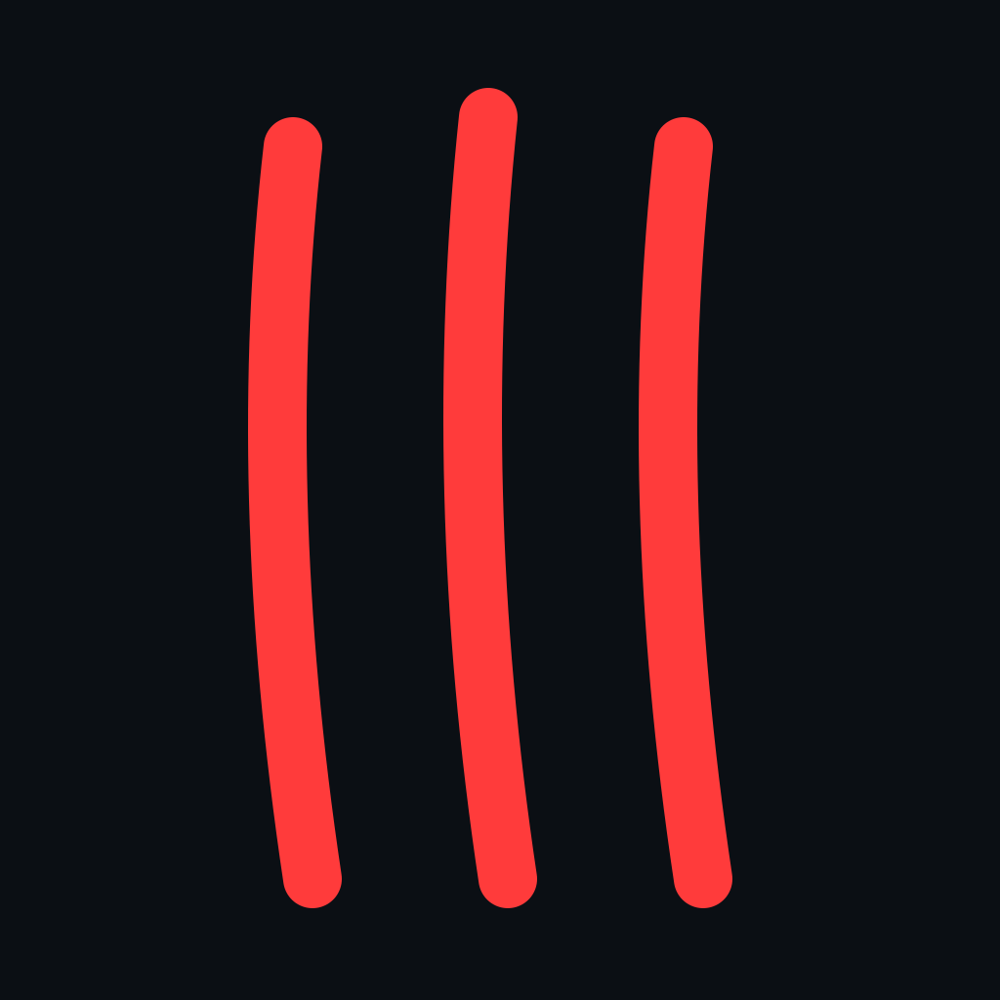

# Beast Boy: The Last Hope

<p align="center">
  
</p>

<p align="center">
  <strong>An ambitious third-person 3D action-adventure game built with Godot 4 and GDScript.</strong>
  <br />
  <em>Crafted as a solo independent game development project by <a href="https://github.com/VaibhavSoni24">Vaibhav Soni</a>.</em>
</p>

<p align="center">
  <a href="https://godotengine.org/"></a>
  <a href="https://github.com/godot-jolt/godot-jolt"></a>
  <a href="LICENSE"></a>
  
  
</p>

---

## 📖 About The Project

**Beast Boy: The Last Hope** is an action-adventure 3D game created in Godot 4 using GDScript. It combines responsive character locomotion, atmospheric cinematic presentation, and an evolving original narrative.

Inspired by timeless classics like **Hollow Knight**, **Super Mario**, and **Resident Evil**, the project blends platforming agility, spatial exploration, tense atmosphere, and character-driven storytelling.

> *"Hope persists even when circumstances seem hopeless."*

At its core, *The Last Hope* centers on an uphill struggle against overwhelming odds, where the choices and courage of a few individuals can change the destiny of their world.

> [!IMPORTANT]
> **Solo Independent Venture**: This entire project—ranging from the finite state machine architecture, dynamic camera system, and custom GLSL shaders to UI design and story concepts—is being independently envisioned and built by a single developer (**Vaibhav Soni**).

---

## 🌌 Lore & The Manhwa Connection

*Beast Boy: The Last Hope* is designed as an expansive multi-medium universe:
- **Interactive Experience**: The 3D Godot game serves as the playable action experience where players explore environments, survive perils, and face adversaries in real-time.
- **The Manhwa Adaptation**: A parallel manhwa (comic) project develops alongside the game. This transmedia approach deepens the world-building, enriches character relationships, and illustrates pivotal narrative sequences beyond the confines of raw gameplay.

### 🎭 Characters
- **Shub (Beast Boy Shub)**: The resilient protagonist standing as a pillar of courage in the face of despair.
- **Xyaa (XyaaLive)**: A vital ally bringing intellect, determination, and tactical balance to the journey.
- **Vaibhav (Shubham)**: An steadfast companion striving alongside his comrades against impossible odds.
- **Dr. Saroj**: The cunning and imposing main antagonist behind the brewing conflict.

---

## 🎮 Core Gameplay Mechanics & Systems

### 1. Modular Player State Machine
The player character is driven by a clean, decoupled **Hierarchical Finite State Machine (HFSM)** (`Scripts/StateMachine/`):
- **Motion States**:
  - `Idle`: Standstill state with automatic sprint stamina recovery.
  - `Run`: Standard 8-directional locomotion mapped to keyboard/controller axes.
  - `Sprint`: High-velocity dash depleting real-time stamina with dynamic camera zoom.
  - `Jump` & `SprintJump`: Velocity-preserving aerial leaps with air-control dampening.
  - `Fall` & `SprintFall`: Gravity-accelerated falls equipped with ground raycasting for smooth transition anticipation.
  - `AimIdle` & `AimWalk`: Over-the-shoulder deliberate aiming stances with tightened FOV and precision movement.

### 2. Math-Driven Physics Resources (`MovementStats`)
Locomotion physics aren't hardcoded magic numbers. They are managed through Godot custom resources (`Resources/player_movement_stats.tres` and `Scripts/Main/movement_stats.gd`), calculating physics curves dynamically:
- **Gravitational Curves**: Gravity is derived from target jump height and apex timing:
  $$\text{Jump Gravity} = \frac{2 \times \text{jump\_height}}{(\text{time\_to\_jump\_apex})^2}$$
  $$\text{Fall Gravity} = \frac{2 \times \text{jump\_height}}{(\text{time\_to\_land})^2}$$
- **Horizontal Velocities**: Speeds are calculated from desired leap distance across airtime:
  $$\text{Velocity} = \frac{\text{distance}}{\text{time\_to\_jump\_apex} + \text{time\_to\_land}}$$
- **Sprint Stamina System**: Dynamic sprint threshold tracking with linear regeneration during idle/walk states.

### 3. Dynamic Dual-SpringArm Camera Rig (`Scripts/camera.gd`)
- **Over-The-Shoulder View**: Uses a nested dual `SpringArm3D` rig (`EdgeSpringArm` for horizontal shoulder offset, `RearSpringArm` for distance and collision avoidance).
- **Instant Shoulder Swap**: Press <kbd>V</kbd> to fluidly glide the camera between Left-Shoulder and Right-Shoulder using exponential ease-out tweens (`Tween.TRANS_EXPO`).
- **Dynamic Field of View (FOV)**:
  - Standard gameplay FOV: $75^\circ$
  - Precision Aiming FOV: $55^\circ$
  - High-Speed Sprint FOV: $90^\circ$
- **Pitch Clamping & Mouse Capture**: Responsive mouse-look with vertical rotation clamping (`clamp(camera_rotation.y, -1.2, 1.2)`).

### 4. Custom GLSL Shader Pipeline
- **Iris Slit Screen Transition (`Shaders/transition.gdshader`)**:
  - A cinematic eye-opening horizontal slit curtain transition.
  - Features real-time sinusoidal light rays, feathering, center bloom, and soft edge glows.
- **Interactive UI Glow & Convolution Blur (`Shaders/button.gdshader` & `Shaders/main_menu.gdshader`)**:
  - Multi-tap kernel convolution sampling for soft halo emission.
  - Breathing pulse animations with subtle pseudo-randomized flicker effects.

### 5. Audiovisual Presentation & Audio Engine
- **Dedicated Audio Buses** in `AudioServer`:
  - `Master`, `Music`, `UI`, `Enemy`, `Gun`, and `Sound`.
- **Dynamic Decibel Sliders (`Scripts/slider.gd`)**:
  - Accurate linear-to-decibel conversion (`db_to_linear` / `linear_to_db`) for distortion-free volume controls.
- **Custom Soundtrack & Audio**:
  - Main theme *"The Sound of Hope"* with custom interactive button focus and click feedback.

---

## 🕹️ Default Keybindings & Controls

| Action | Keyboard / Mouse | Description |
| :--- | :--- | :--- |
| **Move Forward** | <kbd>W</kbd> | Move character forward |
| **Move Backward** | <kbd>S</kbd> | Move character backward |
| **Move Left** | <kbd>A</kbd> | Move character left |
| **Move Right** | <kbd>D</kbd> | Move character right |
| **Look / Rotate** | <kbd>Mouse</kbd> | Control camera orientation |
| **Jump** | <kbd>Space</kbd> | Jump or Sprint Jump |
| **Sprint** | <kbd>Shift</kbd> (Hold) | Sprint with increased FOV and speed |
| **Aim** | <kbd>Right Mouse Button</kbd> (Hold) | Tight over-the-shoulder aim mode |
| **Swap Shoulder** | <kbd>V</kbd> | Toggle camera between Left and Right shoulder |
| **Release Mouse** | <kbd>Escape</kbd> | Toggle mouse cursor capture |

---

## 🏗️ Repository Architecture

```text
Beast-Boy-The-Last-Hope/
├── Assets/
│   ├── Character Models/      # 3D character rigs & FBX models (space_suit_animated.fbx)
│   ├── Main/                  # Menu UI icons, buttons, banners, backgrounds & cursors
│   ├── Prototype Textures/    # Kenney prototype grid textures (SVG/SWF vectors)
│   └── Sound/                 # OST ("The Sound of Hope.mp3"), UI click & focus sounds
├── Resources/
│   └── player_movement_stats.tres  # Exported MovementStats resource instance
├── Scenes/
│   ├── Demo/
│   │   └── demo_world.tscn    # 3D CSG sandbox environment with procedural lighting
│   ├── Others/
│   │   └── intro.tscn         # VideoStreamPlayer intro sequence
│   ├── Parents/
│   │   ├── button.tscn        # Shader-enhanced pulsing interactive button
│   │   ├── player.tscn        # CharacterBody3D rig, camera arms & state machine
│   │   └── slider.tscn        # Audio bus-linked HSlider
│   └── menu.tscn              # Comprehensive multi-screen Main Menu
├── Scripts/
│   ├── Main/
│   │   ├── menu.gd            # Navigation, transitions, resolution, vsync, audio settings
│   │   ├── movement_stats.gd  # Resource definition with jumping/falling math
│   │   └── player.gd          # CharacterBody3D motion delegator
│   ├── StateMachine/
│   │   ├── state.gd           # Abstract State lifecycle class
│   │   ├── state_machine.gd   # Base StateMachine manager
│   │   └── PlayerStateMachine/
│   │       ├── player_state_machine.gd
│   │       └── States/        # Concrete states (Idle, Run, Sprint, Jump, Fall, Aim...)
│   ├── button.gd              # Button hover, scale lerping, and shader control
│   ├── camera.gd              # Dual spring-arm rig, FOV tweening, shoulder swap
│   ├── cursor.gd              # Custom UI mouse cursor setter
│   └── slider.gd              # AudioServer bus sync and volume manipulation
├── Shaders/
│   ├── button.gdshader        # UI button halo emission and pulse shader
│   ├── main_menu.gdshader     # Title bloom and ambient glow shader
│   └── transition.gdshader    # Cinematic slit-curtain transition shader
├── Textures/
│   └── prototype_texture.tres # StandardMaterial3D prototype surface
├── default_bus_layout.tres    # Audio bus definitions
└── project.godot              # Godot 4 configuration (Forward Plus, Jolt 3D physics)
```

---

## 🚀 Getting Started

### Prerequisites
1. **Godot Engine 4.4+ / 4.6**: Download from the official [Godot Engine Website](https://godotengine.org/download).
2. **Jolt Physics**:
   - The project is configured with `physics/3d/physics_engine = "Jolt Physics"`.
   - Ensure the Godot Jolt physics plugin is available or integrated in your Godot build.
3. **Graphics**: GPU supporting the **Forward+** (Vulkan / Direct3D 12) rendering backend.

### Running Locally
1. **Clone the repository**:
   ```bash
   git clone https://github.com/VaibhavSoni24/Beast-Boy-The-Last-Hope.git
   ```
2. **Open Godot**:
   - Open the Godot Project Manager.
   - Click **Import**, navigate to the cloned folder, and select `project.godot`.
   - Click **Import & Edit**.
3. **Play the Game**:
   - Press <kbd>F5</kbd> (or the **Play** button in the top right) to run the main menu (`Scenes/menu.tscn`).
   - To test the 3D locomotion sandbox directly, open `Scenes/Demo/demo_world.tscn` and press <kbd>F6</kbd>.

---

## 🗺️ Roadmap & Current Status

*Beast Boy: The Last Hope* is actively expanding. Current progress and future targets include:

- [x] Responsive 3D movement mechanics (Walk, Run, Jump, Fall)
- [x] Sprint system with stamina duration and threshold replenishment
- [x] Over-the-shoulder dual-springarm camera with dynamic FOV and shoulder swap
- [x] Decoupled Finite State Machine for player locomotion
- [x] Polished cinematic main menu, audio sliders, video options, and UI shaders
- [x] Slit-curtain screen transition pipeline
- [ ] Connect skeletal animations (`AnimationPlayer`/`AnimationTree`) to the state machine
- [ ] Combat system (aiming reticle, firing mechanics, weapons)
- [ ] Enemy AI behavior trees and encounters
- [ ] Story missions, environment design, and dialogue system
- [ ] Manhwa cross-media lore integration

---

## 🤝 Contributing

Contributions, feedback, and ideas are warmly welcome! Whether you are interested in testing physics values, proposing mechanics, or reporting issues, please read our [CONTRIBUTING.md](CONTRIBUTING.md) guide before submitting a pull request.

---

## 📄 License

This project is open-source software licensed under the **[MIT License](LICENSE)**.

---

<p align="center">
  <em>Developed with passion by <a href="https://github.com/VaibhavSoni24">Vaibhav Soni</a>.</em>
</p>
